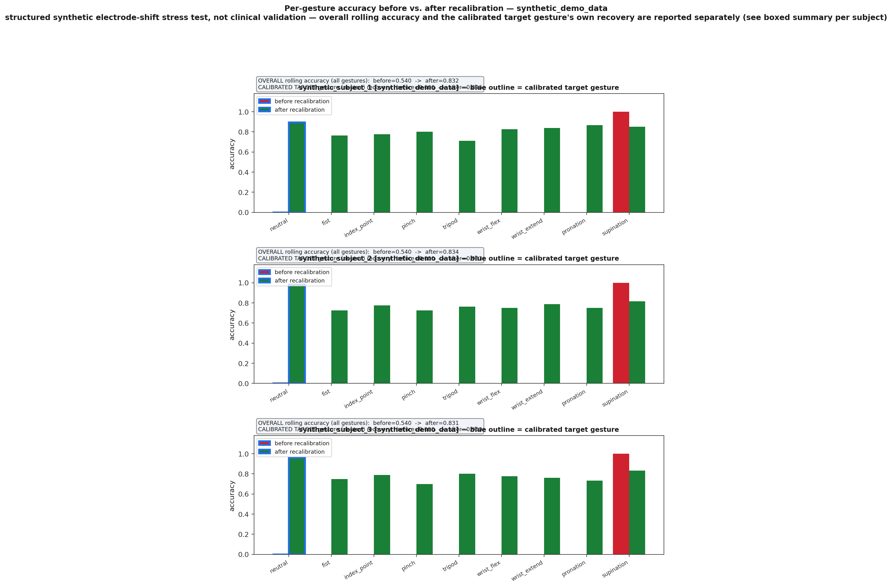
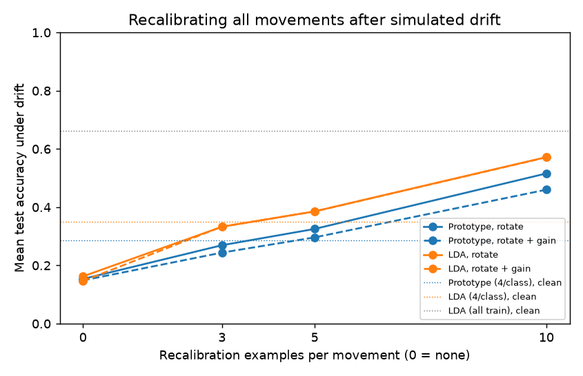
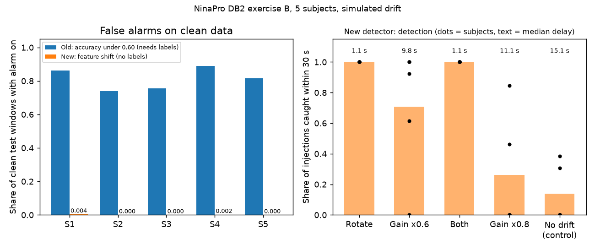

# MyoCopilot

Surface EMG prosthetic control gets worse over a day. Electrodes slide, skin gets sweaty, the socket rotates a few degrees, and a gesture classifier that worked in the morning starts confusing a fist with a rest pose. Most systems just fail quietly. The user only finds out when the hand stops doing what they meant.

I built MyoCopilot to try the opposite: watch for drift while the hand is in use, figure out which gesture broke, ask the user for a few fresh examples of that gesture, and update their profile on the spot.

This is a prototype I built for a hackathon in August 2026. It is not a medical device. The first results were on synthetic data only. I have since run the same pipeline on real recordings from 5 people in NinaPro DB2, and the real numbers are a lot worse. Both are below, and [Limitations](#limitations) covers what they do not show.

## How it works

1. **Stream.** EMG is replayed as if it were live, cut into 250 ms windows with a 50 ms stride. Each window gets RMS and zero crossing features plus a spectrogram image.
2. **Classify.** Each window is classified into one of 9 gestures (rest, fist, index point, pinch, tripod, wrist flex, wrist extend, pronation, supination).
3. **Detect drift.** For the first 30 s of a session a feature drift detector collects labeled windows as enrollment. After that it compares each new window's features with that enrollment, without looking at the label, and raises an alarm when the channel pattern or the overall signal level moves away from it (details under [Drift detection without labels](#drift-detection-without-labels)). Until it has enough enrollment, the app falls back to the original rule: rolling accuracy over 20 labeled windows under 0.60. The pair of gestures that is confused most often decides which gesture to recalibrate.
4. **Recalibrate.** The agent names the gesture that is failing, asks for 3 new repetitions of it, adds them to that user's gesture profile, and keeps going.

A React dashboard shows rolling accuracy, a confusion matrix and the recalibration prompt, and a Three.js hand mirrors the predicted gesture.

There are two classifiers:

- **Default (`MOCK=1`):** a nearest prototype classifier on the RMS and zero crossing features. No network, deterministic, and it is what every MyoCopilot result in this README uses.
- **Experimental:** sends the spectrogram image to a multimodal LLM (GLM-5.3-Flash through OpenRouter) with a few reference images from the user's profile. I wanted to see if a general vision model could read EMG spectrograms at all. I have not evaluated it properly, so I make no accuracy claims for it.

## Results

### Synthetic data

3 synthetic subjects, about 1,400 windows each. Drift is a simulated electrode shift injected partway through the session.

| Subject | Accuracy before drift | After drift | After recalibration |
|---|---|---|---|
| 1 | 0.82 | 0.13 | 0.83 |
| 2 | 0.83 | 0.14 | 0.83 |
| 3 | 0.82 | 0.13 | 0.83 |

Drift was flagged within 1 to 2 seconds of injection in every run, and recovery took 3 new examples of the confused gesture.




What these numbers do and do not show:

- The synthetic EMG is generated by `myosignal/loaders.py` with a fixed amplitude signature per gesture. Real EMG is much messier, so real accuracy will be lower.
- The electrode shift is a simple model I wrote, not a physiological one.
- The k-NN baseline in `eval/baseline_results.json` scored about 0.23, but it was only given 38 training windows, so I do not treat it as a fair comparison yet.

### Real data (NinaPro DB2)

Setup, all in `eval/real_eval.py`:

- NinaPro DB2 exercise B (17 hand and wrist movements, 6 repetitions each), subjects 1 to 5, 12 channels at 2 kHz. I got the files from the CC0 copy on Dryad ([doi:10.5061/dryad.1k84r](https://doi.org/10.5061/dryad.1k84r)).
- Same preprocessing, 250 ms windows, 50 ms stride and RMS plus zero crossing features as the app. I only kept windows that sit entirely inside one repetition of one movement, and left rest out. I used DB2's own 17 movement labels instead of folding them into the app's 9 gestures, so this is a 17 class problem. Chance is about 0.06.
- The standard NinaPro split: train on repetitions 1, 3, 4 and 6, test on 2 and 5.
- **Prototype** is the app's classifier, with its profile built the way the app enrolls during a session: one settled window per repetition, so 4 stored examples per movement.
- **LDA** is scikit-learn's LDA on the same features. "4/class" uses exactly the same 4 windows per movement as the prototype classifier. "All train" uses every training window. **1-NN all** is the prototype rule with no cap on stored examples.

Accuracy on the test repetitions, no drift:

| Subject | Train / test windows | Prototype (4/class) | LDA (4/class) | LDA (all train) | 1-NN (all train) |
|---|---|---|---|---|---|
| 1 | 4639 / 2287 | 0.24 | 0.34 | 0.69 | 0.65 |
| 2 | 5675 / 2790 | 0.35 | 0.37 | 0.66 | 0.63 |
| 3 | 5525 / 2532 | 0.34 | 0.46 | 0.73 | 0.65 |
| 4 | 7454 / 3469 | 0.21 | 0.23 | 0.59 | 0.58 |
| 5 | 4475 / 2275 | 0.30 | 0.35 | 0.64 | 0.61 |
| Mean | | 0.29 | 0.35 | 0.66 | 0.63 |

With the same 4 examples per movement, LDA beats the prototype classifier on every subject, but both are poor. Most of the gap to 0.66 comes from data, not the rule: the prototype rule with all training windows gets 0.63.

Drift is simulated on the real test data, applied before the z-score so the normalisation stays fixed to the clean start of the session. "Rotate" moves the 8 electrodes in the forearm ring by one position (the 4 electrodes on specific muscles stay put). "Gain" scales every channel by 0.6. Recalibration uses k drifted windows per movement taken from the training repetitions, never the test ones. Means over the 5 subjects:

| Condition | Prototype | LDA (4/class) | LDA (all train) |
|---|---|---|---|
| Clean | 0.29 | 0.35 | 0.66 |
| Rotate by one electrode | 0.15 | 0.16 | 0.21 |
| Gain x0.6 | 0.22 | 0.29 | 0.54 |
| Rotate and gain | 0.15 | 0.15 | 0.19 |
| Rotate and gain, recalibrate all movements, k = 3 | 0.24 | 0.33 (refit) | |
| Same, k = 5 | 0.30 | 0.39 (refit) | |
| Same, k = 10 | 0.46 | 0.57 (refit) | |

The prototype classifier stores at most 8 examples per movement, so k = 10 keeps 8. With k = 10 both classifiers end up above their own clean scores, which says more about how few examples they started with than about recovery. Recovery has not levelled off by 10.




The original drift detector and the app's targeted recalibration, run as a stream over the test windows with drift switched on 35% of the way in:

- The detector fired 0.95 s after rotation in all 5 subjects (1.25 s once for gain alone). That number is not meaningful on real data. 0.95 s is just the time it takes to fill its 20 window buffer, and on clean test data its accuracy rule (rolling accuracy under 0.60) is already true for 84% of windows on average (68% to 99% per subject). On real data it would fire constantly. This is why I replaced it, see the next section.
- The app recalibrates only the one movement the detector names. Under rotate and gain, that movement went from 0.01 to 0.71 with 3 examples (0.75 with 5, 0.90 with 10), but overall accuracy for the rest of the stream went down, from 0.15 without recalibration to 0.11 with 3 examples, because every movement drifted and the new examples pull other movements toward the recalibrated one. One-movement recalibration does not fit drift that hits every channel.

Early against late repetitions (train on 1 to 3, test on 4 to 6): prototype 0.24, LDA with the same 3 examples per movement 0.28, LDA on all early windows 0.57. DB2 has one session per subject and the 6 repetitions of a movement are recorded back to back, so this is not a cross-session test. A real cross-session test needs a dataset with several sessions per person.

Run it with the DB2 `S*_E1_A1.mat` files in `data/ninapro_db2/` (the folder is gitignored):

```bash
python -m eval.real_eval --data-dir data/ninapro_db2   # writes eval/real_results.json and eval/report/real_*.png
python -m eval.drift_eval --data-dir data/ninapro_db2  # writes eval/drift_results.json and eval/report/real_drift_detector.png
```

### Drift detection without labels

The accuracy rule above has two problems: it needs the true gesture, which a real user never supplies, and with a classifier this weak it is true most of the time anyway. `agent/feature_drift.py` replaces it with a detector that only looks at the features of each window and compares them with statistics from clean enrollment data. It watches two things:

- **Pattern.** For each window, the Mahalanobis distance from its features (log RMS and zero crossings per channel) to the nearest enrolled movement mean, using a covariance pooled over movements. Averaged over the last 20 windows (1 s). The pattern alarm is on when that average is over its threshold in at least 15 of the last 20 windows. This is what catches an electrode shift, because the channel pattern stops looking like any enrolled movement.
- **Level.** For each window, the mean log RMS over channels minus what a small ridge regression predicts from the zero crossings. Zero crossings do not change when the signal is scaled and RMS does, so a gain change shifts this residual. Averaged over the last 200 windows (10 s, so it spans several movements). The level alarm is on when the absolute average is over its threshold.

Labels are used only at enrollment, to get the movement means, the same way the classifier needs labeled enrollment. Both thresholds are set on the clean training repetitions only, by cross fitting: fit on 3 of the 4 training repetitions, stream the 4th through the detector, repeat. The pattern threshold is the lowest one that keeps the alarm under 1% of those held out windows. The level threshold is 1.25 times the largest level average seen on them. The test repetitions are never used to set either.

Evaluation, all in `eval/drift_eval.py`, same subjects, windows, split and simulated drift as above, plus a milder gain x0.8:

- **False alarms.** The clean test repetitions are streamed in recording order, and I count the share of windows where the alarm is on once the buffers are full.
- **Detection.** For each of 13 injection points spread from 20% to 80% of the test stream, everything before the point is clean and everything after is drifted. The new detector runs over the whole stream and is never reset at the injection point, since a real system would not know when drift starts. A drift counts as caught if the alarm comes on within 30 s. Delay is the median over caught injections.
- **Control.** The same detection protocol with no drift at all. Its "detection rate" is the chance that a false alarm happens to land in the 30 s window, so the other rows should be read against it.

The old detector gets the same streams, restarted at the injection point as in the section above. Means over the 5 subjects:

| | Old: accuracy under 0.60 (needs labels) | New: feature shift (no labels) |
|---|---|---|
| Clean test windows with the alarm on | 81% (74% to 89% per subject) | 0.11% (0% to 0.38%) |
| Alarm episodes per minute on clean data | 10.2 | 0.19 |
| Rotate by one electrode: caught within 30 s, median delay | 100%, 0.95 s | 100%, 1.1 to 1.6 s |
| Gain x0.6 | 100%, 0.95 s | 71%, 6.0 to 10.8 s |
| Rotate and gain | 100%, 0.95 s | 100%, 1.1 to 1.5 s |
| Gain x0.8 | 100%, 0.95 s | 26%, about 11 s |
| No drift (control) | 100%, 0.95 s | 14% |

The old detector "catches" no drift at all just as fast as real drift, which shows its 0.95 s was never a detection. The 81% here is over the whole clean test stream; the 84% in the section above only counted the first 35% of it.

Per subject, for the new detector:

| Subject | Clean windows with alarm | Rotate | Gain x0.6 | Rotate and gain | Gain x0.8 | No drift (control) |
|---|---|---|---|---|---|---|
| 1 | 0.38% | 100%, 1.1 s | 62%, 10.4 s | 100%, 1.1 s | 46%, 10.9 s | 38% |
| 2 | 0% | 100%, 1.6 s | 0% | 100%, 1.5 s | 0% | 0% |
| 3 | 0% | 100%, 1.15 s | 100%, 9.35 s | 100%, 1.15 s | 0% | 0% |
| 4 | 0.18% | 100%, 1.1 s | 100%, 6.0 s | 100%, 1.1 s | 85%, 11.3 s | 31% |
| 5 | 0% | 100%, 1.2 s | 92%, 10.8 s | 100%, 1.15 s | 0% | 0% |

What I take from this:

- Electrode rotation is easy to see without labels. Every injection was caught in every subject, in 1.1 to 1.6 s. The 15 of 20 persistence rule alone accounts for at least 0.75 s of that.
- Gain is much harder. In subjects 3, 4 and 5 the level check caught gain x0.6 in 6 to 11 s. In subject 2 it never did: the threshold there came out at 0.95 in log units (a gain of about x0.39), because on its held out clean training repetitions the 10 s level average already swung by up to 0.76. In subject 1 most of the "catches" came from the pattern check, and its control rate is 38%, so most of those are false alarms that happened to fall in the window.
- Gain x0.8 is mostly below what this detector can see. Only subject 4, which has the tightest threshold (0.31), caught it through the level check. Natural changes in effort from one repetition to the next are about that size.
- Subjects 1 and 4 still had a few false alarms on clean data: 0.58 and 0.37 episodes per minute. That is far better than 10 per minute, but it is not zero.

I also tried, with the same calibration and persistence, two other label free signals in place of the pattern score. A single Mahalanobis distance to all enrollment data (not per movement) got 0.31% clean false alarms and the classifier's own confidence got 0.88%, against 0.10% for the per movement distance. All three caught every rotation.

One choice did use the test data. I ran four level settings (10 s or 20 s average, margin 1.0 or 1.25) and kept 10 s with margin 1.25 after seeing their clean test false alarm rates. With margin 1.0 the clean false alarm rate was 1.06% and gain x0.8 was caught 43% of the time; with a 20 s average and margin 1.0 it was 3.36% and 48%. So the 0.11% above is a bit optimistic, and catching milder gain costs false alarms. All four settings are in `eval/drift_results.json`.



## Running it

```bash
pip install -r requirements.txt
cd frontend && npm install && cd ..

# backend, offline mode
MOCK=1 uvicorn web.server:app --port 8000

# frontend, in a second terminal
cd frontend && npm run dev
```

Open the URL Vite prints (usually http://localhost:5173).

Other commands:

```bash
python -m eval.run        # offline eval, writes eval/results.json
python -m eval.baselines  # k-NN baseline
python -m eval.report     # regenerates the figures in eval/report/
python -m eval.real_eval  # NinaPro DB2 eval, needs the data files (see above)
python -m eval.drift_eval # drift detectors on NinaPro DB2, same data files
pytest -q                 # tests
```

On Windows the same steps are in `scripts/*.ps1`, and there is a `Makefile` if you have make.

To try the LLM classifier, copy `.env.example` to `.env`, set `OPENROUTER_API_KEY`, and start the backend without `MOCK=1`.

## Repo layout

| Path | What's in it |
|---|---|
| `myosignal/` | Loading, filtering, windowing, spectrograms, drift injection |
| `agent/` | Classifiers, drift detector, recalibration, gesture profiles |
| `web/` | FastAPI server (WebSocket stream plus REST) |
| `frontend/` | React dashboard and 3D hand |
| `eval/` | Offline evaluation, baseline, figures |

## Limitations

- Real data results cover 5 of the 40 DB2 subjects, one exercise, and leave out rest. They are offline, not live control.
- On real data the default classifier is weak (0.29 mean accuracy on 17 movements).
- The new drift detector was only tested on simulated drift. It catches a one electrode rotation reliably but misses gain changes in some subjects, misses gain x0.8 in most, and still raised a few false alarms on clean data for 2 of the 5 subjects. Its enrollment needs labeled windows, and the level check needs at least 10 s of each held out enrollment group, so with a short enrollment it stays off.
- In the app the detector says whether drift is happening, but the gesture to recalibrate is still picked from labeled confusions, and after recalibrating one gesture the detector keeps its original enrollment, so a drift that hit every channel will set it off again after the 90 s debounce.
- Drift on real data is simulated (channel rotation and a gain change). It is not recorded electrode movement, sweat, or fatigue. The synthetic drift model is simplified too.
- No cross-session test yet, because DB2 has one session per subject.
- No testing with real users or real prosthetic hardware.
- The LLM classifier is experimental and unevaluated.

## What I'd do next

- ~~Evaluate on NinaPro DB2 with the standard repetition split.~~ Done for 5 subjects (above). A real cross-session test still needs a dataset with more than one session per person.
- ~~Add an LDA baseline trained on the same data.~~ Done on real data. The old k-NN baseline in `eval/baseline_results.json` is still the unfair synthetic one.
- ~~Compare 3 recalibration examples against 5 and 10.~~ Done on real data with simulated drift. Accuracy was still climbing at 10.
- Store more than 4 examples per movement at enrollment, or switch the default classifier to LDA, since both clearly help on real data.
- ~~Stop the drift detector from firing on clean real data.~~ Replaced with a label free feature shift detector (above). Next for it: test it on recorded electrode movement instead of simulated rotation, and see whether a longer enrollment or more than one session gives a tighter level threshold for gain.
- Re-enroll the drift detector after a full recalibration, and pick the gesture to recalibrate without labels.
- Recalibrate all movements when drift looks like an electrode shift, not just the one that was flagged.
- Run the rest of DB2 and include rest as a class.
- Record my own EMG with a cheap armband and test drift from actually moving the electrodes.
