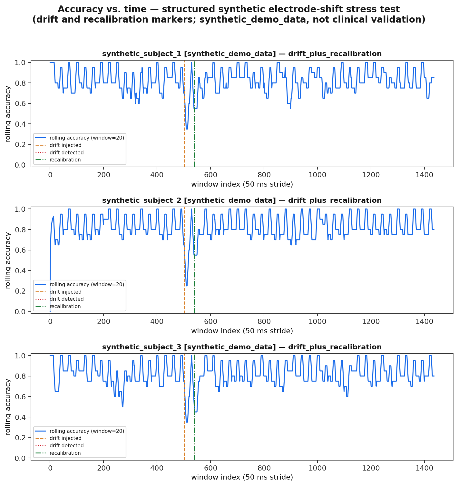

# MyoCopilot

Surface EMG prosthetic control gets worse over a day. Electrodes slide, skin gets sweaty, the socket rotates a few degrees, and a gesture classifier that worked in the morning starts confusing a fist with a rest pose. Most systems just fail quietly. The user only finds out when the hand stops doing what they meant.

I built MyoCopilot to try the opposite: watch for drift while the hand is in use, figure out which gesture broke, ask the user for a few fresh examples of that gesture, and update their profile on the spot.

This is a prototype I built for a hackathon in August 2026. It is not a medical device, and the numbers below come from synthetic data, not people. More on that in [Limitations](#limitations).

## How it works

1. **Stream.** EMG is replayed as if it were live, cut into 250 ms windows with a 50 ms stride. Each window gets RMS and zero crossing features plus a spectrogram image.
2. **Classify.** Each window is classified into one of 9 gestures (rest, fist, index point, pinch, tripod, wrist flex, wrist extend, pronation, supination).
3. **Detect drift.** A detector tracks rolling accuracy and which pairs of gestures keep getting confused. It flags drift when accuracy drops under 0.60 or one confusion pair takes over 25% of recent windows.
4. **Recalibrate.** The agent names the gesture that is failing, asks for 3 new repetitions of it, adds them to that user's gesture profile, and keeps going.

A React dashboard shows rolling accuracy, a confusion matrix and the recalibration prompt, and a Three.js hand mirrors the predicted gesture.

There are two classifiers:

- **Default (`MOCK=1`):** a nearest prototype classifier on the RMS and zero crossing features. No network, deterministic, and it is what every result in this README uses.
- **Experimental:** sends the spectrogram image to a multimodal LLM (GLM-5.3-Flash through OpenRouter) with a few reference images from the user's profile. I wanted to see if a general vision model could read EMG spectrograms at all. I have not evaluated it properly, so I make no accuracy claims for it.

## Results (synthetic data)

3 synthetic subjects, about 1,400 windows each. Drift is a simulated electrode shift injected partway through the session.

| Subject | Accuracy before drift | After drift | After recalibration |
|---|---|---|---|
| 1 | 0.82 | 0.13 | 0.83 |
| 2 | 0.83 | 0.14 | 0.83 |
| 3 | 0.82 | 0.13 | 0.83 |

Drift was flagged within 1 to 2 seconds of injection in every run, and recovery took 3 new examples of the confused gesture.




What these numbers do and do not show:

- The synthetic EMG is generated by `myosignal/loaders.py` with a fixed amplitude signature per gesture. Real EMG is much messier, so real accuracy will be lower.
- The electrode shift is a simple model I wrote, not a physiological one.
- The k-NN baseline in `eval/baseline_results.json` scored about 0.23, but it was only given 38 training windows, so I do not treat it as a fair comparison yet.

The pipeline can load real recordings (NinaPro DB2 `.mat` and Meta emg2pose `.hdf5`) from `data/`. Running the eval on NinaPro DB2 is the next thing I want to do.

## Running it

```bash
pip install -r requirements.txt
cd frontend && npm install && cd ..

# backend, offline mode
MOCK=1 uvicorn web.server:app --port 8000

# frontend, in a second terminal
cd frontend && npm run dev
```

Open the URL Vite prints (usually http://localhost:5173).

Other commands:

```bash
python -m eval.run        # offline eval, writes eval/results.json
python -m eval.baselines  # k-NN baseline
python -m eval.report     # regenerates the figures in eval/report/
pytest -q                 # tests
```

On Windows the same steps are in `scripts/*.ps1`, and there is a `Makefile` if you have make.

To try the LLM classifier, copy `.env.example` to `.env`, set `OPENROUTER_API_KEY`, and start the backend without `MOCK=1`.

## Repo layout

| Path | What's in it |
|---|---|
| `myosignal/` | Loading, filtering, windowing, spectrograms, drift injection |
| `agent/` | Classifiers, drift detector, recalibration, gesture profiles |
| `web/` | FastAPI server (WebSocket stream plus REST) |
| `frontend/` | React dashboard and 3D hand |
| `eval/` | Offline evaluation, baseline, figures |

## Limitations

- All reported results are on synthetic data.
- No testing with real users or real prosthetic hardware.
- The drift model is simplified.
- The LLM classifier is experimental and unevaluated.

## What I'd do next

- Evaluate on NinaPro DB2 with a proper train and test split across sessions.
- Retrain the k-NN and an LDA baseline with the same amount of data so the comparison is fair.
- Compare 3 recalibration examples against 5 and 10 to see where recovery levels off.
- Record my own EMG with a cheap armband and test drift from actually moving the electrodes.
