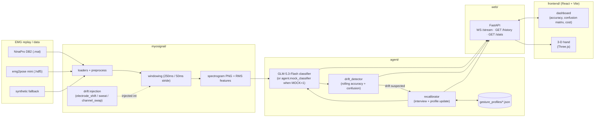

# MyoCopilot

**An adaptive myoelectric prosthetic-control copilot that detects EMG drift and conversationally recalibrates before control fails.**

Hackathon build — research prototype, not a medical device. See [Limitations](#limitations).

---

## The problem

Surface EMG (sEMG) control signals for a prosthetic hand drift over the course of a day: electrodes shift position, sweat degrades skin-electrode contact, a harness rotates. A gesture classifier trained (or few-shot primed) on a clean signal quietly starts misfiring, and the user is left fighting a hand that no longer does what they intend — with no easy way to tell the system what changed.

## What MyoCopilot does

Public sEMG datasets (NinaPro DB2 `.mat` files, Meta emg2pose mini HDF5) are replayed as a simulated live stream, windowed, turned into spectrogram images, and classified by GLM-5.3-Flash via OpenRouter. A drift detector watches rolling accuracy and confusion patterns; when it suspects drift, the agent **asks the user** to perform the confused gesture a few times, folds the fresh spectrogram examples into that user's gesture profile, and keeps going — recalibrating conversationally instead of failing silently.

**User experience:** stream → classify → detect drift → ask for calibration samples → personalize gesture profile → recover control.

A 3-D hand (`assets/hand.html`, procedural Three.js) mirrors recognized gestures live; a React dashboard shows rolling accuracy, a confusion matrix, and running API cost.

## Architecture



## Technical stack

**Backend:** Python, FastAPI, WebSockets, SciPy (signal processing), scikit-learn (baseline + metrics), matplotlib (report figures), httpx (OpenRouter client).
**Frontend:** React, Vite, TypeScript, Three.js (3-D hand), Recharts (charts), Zustand (state).
**Model:** GLM-5.3-Flash via [OpenRouter](https://openrouter.ai) (`z-ai/glm-5.3-flash`), multimodal spectrogram classification.

## Repository layout

| Path | Owns |
|---|---|
| `myosignal/` | dataset loading, windowing, spectrograms, drift injection |
| `agent/` | classifier, drift detection, recalibration, cost tracking |
| `web/` | FastAPI app (WebSocket + REST) |
| `frontend/` | React/Vite dashboard + 3-D hand integration |
| `assets/hand.html` | standalone procedural 3-D hand |
| `eval/` | offline evaluation harness, classical baseline, report figures, demo script |

See [CLAUDE.md](CLAUDE.md) for the full data contracts and parallel-session ownership map.

---

## Local Windows quickstart

```powershell
# 1. Install dependencies
py -m pip install -r requirements.txt
cd frontend; npm install; cd ..

# 2. (optional) real-mode secrets — skip entirely for MOCK mode
copy .env.example .env
# edit .env: set OPENROUTER_API_KEY=<your key>
```

Or via the orchestration scripts (works with or without GNU `make` — see below):

```powershell
.\scripts\setup.ps1
```

### Mock demo mode (no API key, no network)

Runs the full pipeline with `agent.mock_classifier`, a network-free RMS heuristic. No `OPENROUTER_API_KEY` required.

```powershell
# terminal 1
$env:MOCK = "1"
py -m uvicorn web.server:app --reload --port 8000

# terminal 2
cd frontend
npm run dev
```

Open the printed Vite URL (typically `http://localhost:5173`) — the dev server proxies `/stream`, `/history`, `/stats` to the backend on `:8000` (see `frontend/vite.config.ts`).

Headless (no browser at all):

```powershell
.\scripts\demo.ps1
```

### Real OpenRouter mode

```powershell
copy .env.example .env
# edit .env: OPENROUTER_API_KEY=sk-or-...
py -m uvicorn web.server:app --reload --port 8000   # MOCK unset -> real GLM-5.3-Flash calls
cd frontend; npm run dev
```

**Never commit `.env` or paste a real key into this repo** — `.env` is gitignored; `.env.example` stays empty.

### Using GNU `make` instead

If `make` is available (Git Bash, WSL, or `choco install make`), the same commands are:

# MyoCopilot

> An adaptive myoelectric prosthetic-control copilot that detects EMG drift and conversationally recalibrates personalized gesture profiles before control fails.

🎥 **Demo video:** [Watch the MyoCopilot demo](REPLACE_WITH_VIDEO_URL)

Hackathon build — research prototype, not a medical device. See [Limitations](#limitations).

## Demo

| Stable control | Drift detected | Personalized recovery |
|---|---|---|
|  |  |  |

Add three real browser screenshots before submission: clean control above the safety threshold, drift detection with the recalibration panel, and target-gesture recovery after fresh confirmation samples.

## Why GLM-5.3-Flash?

- GLM-5.3-Flash is integrated through OpenRouter as MyoCopilot’s production multimodal reasoning/classification path.
- EMG windows are represented as multi-channel spectrograms plus compact session context and personalized calibration examples.
- GLM supports the system’s multimodal pattern interpretation, agentic drift reasoning, and user-specific recalibration workflow.
- The reproducible recording uses structured synthetic EMG-like signals and `MOCK=1`.
- The real GLM-5.3-Flash path remains available for live OpenRouter testing.

Do not treat this as medical validation or clinical accuracy — the mock recording and synthetic sessions are reproducible demos, not clinical evidence.

## Demo flow

1. A subject-specific EMG profile establishes stable gesture control.
2. MyoCopilot streams gesture predictions to the bionic hand dashboard.
3. A structured synthetic electrode-shift stress test degrades the learned signal profile.
4. Rolling accuracy and confidence trigger drift detection.
5. The agent identifies the most affected gesture confusion.
6. MyoCopilot asks for three fresh confirmations of the affected gesture.
7. The personalized gesture profile updates and target-gesture control recovers.

## Repository map

| Directory / file | Purpose |
|---|---|
| `agent/` | GLM integration, mock classifier, drift detection, cost tracking, and conversational recalibration logic |
| `myosignal/` | EMG loading, preprocessing, feature extraction, spectrogram generation, and deterministic synthetic signal replay |
| `web/` | FastAPI service, WebSocket stream, REST endpoints, and backend orchestration |
| `frontend/` | React/Vite dashboard, 3D bionic hand integration, charts, controls, and demo mode |
| `eval/` | Offline evaluation, k-NN baseline, headless demo harness, and report figures |
| `assets/` | Bionic hand source assets and visual resources |
| `scripts/` | Windows PowerShell setup, test, backend, frontend, demo, evaluation, and reporting commands |
| `Dockerfile` / `serve.py` | Single-container deployment preparation for the frontend and API |

See [CLAUDE.md](CLAUDE.md) for the full data contracts and parallel-session ownership map.

## Reproducibility and safety

- The default demo uses deterministic structured synthetic EMG-like data labeled `synthetic_demo_data`.
- The electrode-shift condition is a structured synthetic stress test, not a clinically validated physiological model.
- The project is a research/hackathon prototype and not a medical device.
- Reported evaluation results do not establish clinical performance.
- Real API keys must live only in `.env`.
- `.env` must never be committed.
- `.env.example` must contain no secret value.

---

## Local Windows quickstart

```powershell
# Backend: reproducible demo mode
$env:MOCK="1"
py -m uvicorn web.server:app --reload --port 8000
```

```powershell
# Frontend
cd frontend
npm install
npm run dev
```

```powershell
# Test the full project
py -m pytest -q
cd frontend
npm run build
```

Preserve the rest of the detailed instructions and architecture in the original README for maintainers and reviewers.

## Evaluation

- Distinguishes clean, drift, and drift-plus-recalibration conditions.
- See `eval/results.json` and `eval/report/` for evaluation outputs and figures.
- All evaluation runs in CI/demo mode use synthetic data by default (`synthetic_demo_data`) — see the reproducibility disclaimer above.
- The repository includes a transparent k-NN RMS baseline as a classical comparison (see `eval/baselines.py` and `eval/baseline_results.json`).

## Limitations

- Synthetic/replay data by default.
- Simplified structured drift model.
- No clinical validation.
- No human-subject trial.
- Multimodal LLM interpretation remains exploratory in this setting.
- A real deployment would require hardware integration, safety testing, user studies, and clinical validation.

## Hackathon tracks

> MyoCopilot is submitted to the GLM-5.3-Flash Lightning Hackathon’s **Frontier Build** track for its multimodal, agentic adaptive-control pipeline. It is also designed for the **Most Viral** track through its visual bionic-hand demo: stable control → electrode shift → drift detection → conversational recovery.
