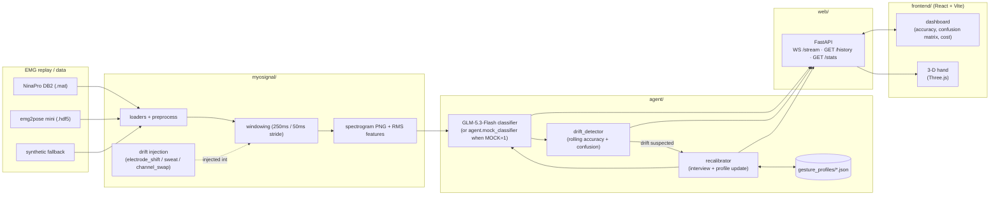

# MyoCopilot

**An adaptive myoelectric prosthetic-control copilot that detects EMG drift and conversationally recalibrates before control fails.**

Hackathon build — research prototype, not a medical device. See [Limitations](#limitations).

---

## The problem

Surface EMG (sEMG) control signals for a prosthetic hand drift over the course of a day: electrodes shift position, sweat degrades skin-electrode contact, a harness rotates. A gesture classifier trained (or few-shot primed) on a clean signal quietly starts misfiring, and the user is left fighting a hand that no longer does what they intend — with no easy way to tell the system what changed.

## What MyoCopilot does

Public sEMG datasets (NinaPro DB2 `.mat` files, Meta emg2pose mini HDF5) are replayed as a simulated live stream, windowed, turned into spectrogram images, and classified by GLM-5.3-Flash via OpenRouter. A drift detector watches rolling accuracy and confusion patterns; when it suspects drift, the agent **asks the user** to perform the confused gesture a few times, folds the fresh spectrogram examples into that user's gesture profile, and keeps going — recalibrating conversationally instead of failing silently.

**User experience:** stream → classify → detect drift → ask for calibration samples → personalize gesture profile → recover control.

A 3-D hand (`assets/hand.html`, procedural Three.js) mirrors recognized gestures live; a React dashboard shows rolling accuracy, a confusion matrix, and running API cost.

## Architecture



## Technical stack

**Backend:** Python, FastAPI, WebSockets, SciPy (signal processing), scikit-learn (baseline + metrics), matplotlib (report figures), httpx (OpenRouter client).
**Frontend:** React, Vite, TypeScript, Three.js (3-D hand), Recharts (charts), Zustand (state).
**Model:** GLM-5.3-Flash via [OpenRouter](https://openrouter.ai) (`z-ai/glm-5.3-flash`), multimodal spectrogram classification.

## Repository layout

| Path | Owns |
|---|---|
| `myosignal/` | dataset loading, windowing, spectrograms, drift injection |
| `agent/` | classifier, drift detection, recalibration, cost tracking |
| `web/` | FastAPI app (WebSocket + REST) |
| `frontend/` | React/Vite dashboard + 3-D hand integration |
| `assets/hand.html` | standalone procedural 3-D hand |
| `eval/` | offline evaluation harness, classical baseline, report figures, demo script |

See [CLAUDE.md](CLAUDE.md) for the full data contracts and parallel-session ownership map.

---

## Local Windows quickstart

```powershell
# 1. Install dependencies
py -m pip install -r requirements.txt
cd frontend; npm install; cd ..

# 2. (optional) real-mode secrets — skip entirely for MOCK mode
copy .env.example .env
# edit .env: set OPENROUTER_API_KEY=<your key>
```

Or via the orchestration scripts (works with or without GNU `make` — see below):

```powershell
.\scripts\setup.ps1
```

### Mock demo mode (no API key, no network)

Runs the full pipeline with `agent.mock_classifier`, a network-free RMS heuristic. No `OPENROUTER_API_KEY` required.

```powershell
# terminal 1
$env:MOCK = "1"
py -m uvicorn web.server:app --reload --port 8000

# terminal 2
cd frontend
npm run dev
```

Open the printed Vite URL (typically `http://localhost:5173`) — the dev server proxies `/stream`, `/history`, `/stats` to the backend on `:8000` (see `frontend/vite.config.ts`).

Headless (no browser at all):

```powershell
.\scripts\demo.ps1
```

### Real OpenRouter mode

```powershell
copy .env.example .env
# edit .env: OPENROUTER_API_KEY=sk-or-...
py -m uvicorn web.server:app --reload --port 8000   # MOCK unset -> real GLM-5.3-Flash calls
cd frontend; npm run dev
```

**Never commit `.env` or paste a real key into this repo** — `.env` is gitignored; `.env.example` stays empty.

### Using GNU `make` instead

If `make` is available (Git Bash, WSL, or `choco install make`), the same commands are:

```bash
make setup      # install Python + frontend deps
make backend    # MOCK=1 FastAPI backend on :8000
make frontend   # Vite dev server
make demo       # headless scripted demo
make eval       # offline evaluation + classical baseline
make report     # regenerate eval/report/*.png
make test       # pytest + frontend build
```

Each `make` target has a `.\scripts\*.ps1` equivalent for plain PowerShell.

---

## Evaluation

> **Synthetic-vs-real-data disclaimer:** `data/` ships empty (gitignored). Unless you drop real NinaPro DB2 `.mat` or emg2pose `.hdf5` files there yourself, every evaluation run below uses **deterministic synthetic sessions** — every result is tagged `"data_source": "synthetic_demo_data"` in `eval/results.json` and captioned as such in every figure. Nothing here has been validated against real EMG or any clinical population.
>
> The default demo uses deterministic, structured EMG-like synthetic signals designed to exercise the adaptive-control pipeline. These signals are not clinical recordings and reported results do not establish medical-device performance.

```powershell
py -m eval.run        # offline harness: clean / drift / drift_plus_recalibration
                       # x up to 3 subjects -> eval/results.json
py -m eval.baselines   # honest k-NN-on-RMS classical baseline -> eval/baseline_results.json
py -m eval.report      # figures from the above -> eval/report/*.png
```

`eval/run.py` always classifies through `agent.mock_classifier` (never OpenRouter, regardless of `MOCK`), and estimates what the real GLM-5.3-Flash path *would* cost using the pricing constants in `agent/cost_tracker.py` — those `estimated_tokens` / `estimated_cost_usd` figures are projections, not measurements.

**Honest findings, not a sales pitch (all `synthetic_demo_data` — see the disclaimer above):**
- `agent.mock_classifier` is a deterministic, per-subject nearest-prototype classifier built purely from RMS/zero-crossing features (never the spectrogram, never `true_gesture`). On the structured synthetic sessions generated by `myosignal.loaders.make_synthetic_session`, clean accuracy across 3 subjects is **0.70–0.72** overall (including its own early bootstrap/warm-up phase) and **≥0.80** once bootstrap has actually finished — well above the classical k-NN-on-RMS baseline's **~0.23–0.24** on the same features. See `eval/report/baseline_comparison.png`.
- `myosignal.loaders.make_synthetic_session` now exercises **all 9** `POSE_SET` gestures with a fixed, overlapping-but-distinct 12-channel activation signature per gesture — not the earlier channel-identical IID noise that only varied by a random per-burst amplitude scale.
- The `drift` condition uses a **structured synthetic electrode-shift stress test** (`myosignal.player.apply_electrode_shift_stress`): a deterministic whole-12-channel permutation, a fixed per-channel gain (0.45x–1.70x), small channel-dependent baseline wander/contact noise, and two channels losing most contact. This is **not** a clinical or biomechanical model of real electrode drift — it's a deliberately severe stress test. Aggregate post-injection rolling accuracy drops to **0.13–0.54** across the 3 subjects (well under `DriftDetector`'s 0.60 threshold), and the drift detector fires only ~19–36 windows *after* injection, never before.
- `drift_plus_recalibration`: once the confused gesture is identified, `agent.recalibrator.recalibrate()`'s existing 3-sample flow (fixed this round to grade `acc_after` only on windows whose `true_gesture` matches the recalibrated target, bounded by a max-scan limit — it previously could silently grade the wrong gesture) replaces that gesture's reference profile. Its own before/after accuracy recovers to **0.83–0.98** across subjects — a real, measured recovery, not the classifier "learning" a few-shot image profile (the mock path never touches the spectrogram). `eval/report.py`'s `recalibration_before_after.png` now reports this **calibrated target-gesture recovery** separately from the **overall rolling accuracy** across all gestures in the same post-recalibration window (0.83–0.83 overall in this run) — the two can differ since only the target gesture's profile was replaced.

## 90-second demo script

1. **0s** — Clean EMG stream begins; dashboard shows the 3-D hand tracking gestures and rolling accuracy climbing.
2. **~25s** — Operator injects the structured `electrode_shift` stress test (button, or auto-injected in the headless script) — comfortably after the ~15s bootstrap window so every gesture already has a stable reference profile.
3. **~30s** — Rolling accuracy drops under threshold; the drift detector flags a dominant confusion pair (observed 4–20s after injection).
4. Agent posts a conversational recalibration request: *"I'm mixing up 'X' with 'Y' — could you perform 'X' a few times?"*
5. Three fresh spectrogram samples of the confused gesture are accepted (collection walks a fresh synthetic stream from t=0, so wall-clock time to find the target gesture varies run to run).
6. `gesture_profiles/<subject>.json` is updated with the new few-shot examples, and `agent.mock_classifier`'s own reference profile for that gesture is replaced.
7. Recovery confirmed; rolling accuracy climbs back up, hand resumes correct gestures.

Run it headless, deterministically, with no browser and no API key:

```powershell
.\scripts\demo.ps1
```

`eval/demo.py` narrates the *actual* elapsed time for each step next to this target timeline — see its module docstring for why real timing varies run to run.

---

## Deployment (Docker / Zeabur)

A single-container deployment builds the frontend, then serves both the API/WebSocket and the built dashboard from one `uvicorn` process on one port:

```bash
docker build -t myocopilot .
docker run -p 8000:8000 -e OPENROUTER_API_KEY=sk-or-... myocopilot   # real mode
docker run -p 8000:8000 myocopilot                                   # MOCK=1 by default (no key given)
```

- `Dockerfile` is a two-stage build: `frontend-build` (Node 20, `npm ci && npm run build`) → `runtime` (Python 3.11-slim, installs `requirements.txt`, copies `myosignal/`, `agent/`, `web/`, `assets/`, and the built `frontend/dist/`).
- `serve.py` imports the existing `web.server:app` **unchanged** and mounts `frontend/dist/` onto it as a catch-all static route — `web/server.py` itself is never modified. The frontend already builds same-origin URLs (`window.location.host`, relative `/history` and `/stats` fetches), so no frontend changes were needed either.
- `docker-entrypoint.sh` reads `OPENROUTER_API_KEY` only from the environment (never baked into the image) and defaults to `MOCK=1` whenever neither `OPENROUTER_API_KEY` nor `MOCK` is supplied, so the container never silently fails trying to call OpenRouter with no key.
- Listens on `$PORT` if the platform sets one, else `8000` (`EXPOSE 8000`).
- **Verified locally**: `docker build` succeeds and the resulting container serves `/stats` (API) and `/` (dashboard) correctly with no environment variables set at all (MOCK-by-default path).

Zeabur auto-detects a root `Dockerfile` — push this repo and set `OPENROUTER_API_KEY` in its environment-variables UI for real mode, or leave it unset to deploy in MOCK mode.

---

## Limitations

- **Research prototype, not a medical device.** Nothing here has been through any regulatory or clinical process.
- **Replay/synthetic testing only.** All demo and evaluation data is either replayed public dataset recordings or synthetic; no real-time acquisition hardware, no live human-in-the-loop EMG testing.
- **No clinical validation.** Accuracy numbers (mock or real) describe this software pipeline's behavior on this data, nothing about real-world prosthetic control performance.
- **Simplified drift model.** `myosignal/drift.py`'s three artefacts (`electrode_shift`, `sweat`, `channel_swap`) and `myosignal/player.py`'s severer `apply_electrode_shift_stress` (used for the synthetic/replay `electrode_shift` condition specifically) are deterministic, hand-designed corruptions — a reasonable stand-in for the *shape* of real drift, not a validated biomechanical/electrophysiological model of it. Treat `eval.run`'s `drift` condition as a **structured synthetic electrode-shift stress test**, not clinical validation.
- **LLM visual classification is exploratory.** Classifying a rendered spectrogram image via a general multimodal LLM (rather than a purpose-trained EMG classifier) is the core experiment here, not an established clinical technique.
- **The MOCK classifier is a deterministic nearest-prototype model, not a trained one** (see [Evaluation](#evaluation)) — it exists so the pipeline, dashboard, and demo can run with zero network dependency. It performs well on the structured synthetic signatures here; that says nothing about real classification quality on genuine EMG.

## Credits / licenses

- **3-D hand** (`assets/hand.html`): procedurally generated in this project using [Three.js](https://threejs.org) r160 (MIT License), loaded via the jsDelivr CDN import map — no external mesh or asset files.
- **Fonts:** IBM Plex Mono and Space Grotesk via Google Fonts.
- **Datasets:** [NinaPro DB2](http://ninapro.hevs.ch/) and [Meta emg2pose](https://github.com/facebookresearch/emg2pose) (not redistributed in this repository — see their own licenses for usage terms).
- **Model:** GLM-5.3-Flash, served via [OpenRouter](https://openrouter.ai).

No API key is ever committed to this repository. `.env` is gitignored; `.env.example` is intentionally empty.
