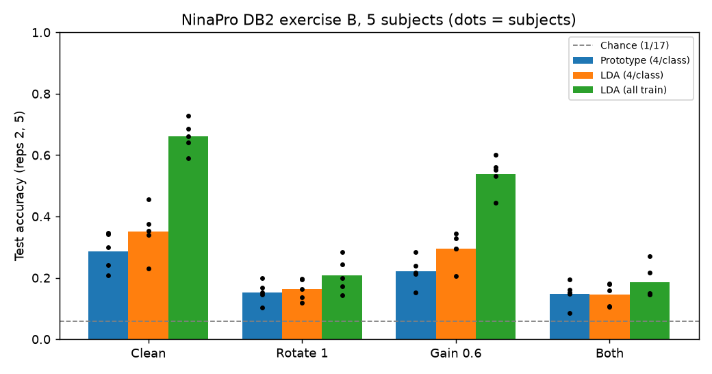

# MyoCopilot

Surface EMG prosthetic control gets worse over a day. Electrodes slide, skin gets sweaty, the socket rotates a few degrees, and a gesture classifier that worked in the morning starts confusing a fist with a rest pose. Most systems just fail quietly. The user only finds out when the hand stops doing what they meant.

I built MyoCopilot to try the opposite: watch for drift while the hand is in use, figure out which gesture broke, ask the user for a few fresh examples of that gesture, and update their profile on the spot.

This is a prototype I built for a hackathon in August 2026. It is not a medical device. The first results were on synthetic data only. I have since run the same pipeline on real recordings from 5 people in NinaPro DB2, and the real numbers are a lot worse. Both are below, and [Limitations](#limitations) covers what they do not show.

## How it works

1. **Stream.** EMG is replayed as if it were live, cut into 250 ms windows with a 50 ms stride. Each window gets RMS and zero crossing features plus a spectrogram image.
2. **Classify.** Each window is classified into one of 9 gestures (rest, fist, index point, pinch, tripod, wrist flex, wrist extend, pronation, supination).
3. **Detect drift.** A detector tracks rolling accuracy and which pairs of gestures keep getting confused. It flags drift when accuracy drops under 0.60 or one confusion pair takes over 25% of recent windows.
4. **Recalibrate.** The agent names the gesture that is failing, asks for 3 new repetitions of it, adds them to that user's gesture profile, and keeps going.

A React dashboard shows rolling accuracy, a confusion matrix and the recalibration prompt, and a Three.js hand mirrors the predicted gesture.

There are two classifiers:

- **Default (`MOCK=1`):** a nearest prototype classifier on the RMS and zero crossing features. No network, deterministic, and it is what every MyoCopilot result in this README uses.
- **Experimental:** sends the spectrogram image to a multimodal LLM (GLM-5.3-Flash through OpenRouter) with a few reference images from the user's profile. I wanted to see if a general vision model could read EMG spectrograms at all. I have not evaluated it properly, so I make no accuracy claims for it.

## Results

### Synthetic data

3 synthetic subjects, about 1,400 windows each. Drift is a simulated electrode shift injected partway through the session.

| Subject | Accuracy before drift | After drift | After recalibration |
|---|---|---|---|
| 1 | 0.82 | 0.13 | 0.83 |
| 2 | 0.83 | 0.14 | 0.83 |
| 3 | 0.82 | 0.13 | 0.83 |

Drift was flagged within 1 to 2 seconds of injection in every run, and recovery took 3 new examples of the confused gesture.


What these numbers do and do not show:

- The synthetic EMG is generated by `myosignal/loaders.py` with a fixed amplitude signature per gesture. Real EMG is much messier, so real accuracy will be lower.
- The electrode shift is a simple model I wrote, not a physiological one.
- The k-NN baseline in `eval/baseline_results.json` scored about 0.23, but it was only given 38 training windows, so I do not treat it as a fair comparison yet.

### Real data (NinaPro DB2)

Setup, all in `eval/real_eval.py`:

- NinaPro DB2 exercise B (17 hand and wrist movements, 6 repetitions each), subjects 1 to 5, 12 channels at 2 kHz. I got the files from the CC0 copy on Dryad ([doi:10.5061/dryad.1k84r](https://doi.org/10.5061/dryad.1k84r)).
- Same preprocessing, 250 ms windows, 50 ms stride and RMS plus zero crossing features as the app. I only kept windows that sit entirely inside one repetition of one movement, and left rest out. I used DB2's own 17 movement labels instead of folding them into the app's 9 gestures, so this is a 17 class problem. Chance is about 0.06.
- The standard NinaPro split: train on repetitions 1, 3, 4 and 6, test on 2 and 5.
- **Prototype** is the app's classifier, with its profile built the way the app enrolls during a session: one settled window per repetition, so 4 stored examples per movement.
- **LDA** is scikit-learn's LDA on the same features. "4/class" uses exactly the same 4 windows per movement as the prototype classifier. "All train" uses every training window. **1-NN all** is the prototype rule with no cap on stored examples.

Accuracy on the test repetitions, no drift:

| Subject | Train / test windows | Prototype (4/class) | LDA (4/class) | LDA (all train) | 1-NN (all train) |
|---|---|---|---|---|---|
| 1 | 4639 / 2287 | 0.24 | 0.34 | 0.69 | 0.65 |
| 2 | 5675 / 2790 | 0.35 | 0.37 | 0.66 | 0.63 |
| 3 | 5525 / 2532 | 0.34 | 0.46 | 0.73 | 0.65 |
| 4 | 7454 / 3469 | 0.21 | 0.23 | 0.59 | 0.58 |
| 5 | 4475 / 2275 | 0.30 | 0.35 | 0.64 | 0.61 |
| Mean | | 0.29 | 0.35 | 0.66 | 0.63 |

With the same 4 examples per movement, LDA beats the prototype classifier on every subject, but both are poor. Most of the gap to 0.66 comes from data, not the rule: the prototype rule with all training windows gets 0.63.

Drift is simulated on the real test data, applied before the z-score so the normalisation stays fixed to the clean start of the session. "Rotate" moves the 8 electrodes in the forearm ring by one position (the 4 electrodes on specific muscles stay put). "Gain" scales every channel by 0.6. Recalibration uses k drifted windows per movement taken from the training repetitions, never the test ones. Means over the 5 subjects:

| Condition | Prototype | LDA (4/class) | LDA (all train) |
|---|---|---|---|
| Clean | 0.29 | 0.35 | 0.66 |
| Rotate by one electrode | 0.15 | 0.16 | 0.21 |
| Gain x0.6 | 0.22 | 0.29 | 0.54 |
| Rotate and gain | 0.15 | 0.15 | 0.19 |
| Rotate and gain, recalibrate all movements, k = 3 | 0.24 | 0.33 (refit) | |
| Same, k = 5 | 0.30 | 0.39 (refit) | |
| Same, k = 10 | 0.46 | 0.57 (refit) | |

The prototype classifier stores at most 8 examples per movement, so k = 10 keeps 8. With k = 10 both classifiers end up above their own clean scores, which says more about how few examples they started with than about recovery. Recovery has not levelled off by 10.




The drift detector and the app's targeted recalibration, run as a stream over the test windows with drift switched on 35% of the way in:

- The detector fired 0.95 s after rotation in all 5 subjects (1.25 s once for gain alone). That number is not meaningful on real data. 0.95 s is just the time it takes to fill its 20 window buffer, and on clean test data its accuracy rule (rolling accuracy under 0.60) is already true for 84% of windows on average (68% to 99% per subject). On real data it would fire constantly.
- The app recalibrates only the one movement the detector names. Under rotate and gain, that movement went from 0.01 to 0.71 with 3 examples (0.75 with 5, 0.90 with 10), but overall accuracy for the rest of the stream went down, from 0.15 without recalibration to 0.11 with 3 examples, because every movement drifted and the new examples pull other movements toward the recalibrated one. One-movement recalibration does not fit drift that hits every channel.

Early against late repetitions (train on 1 to 3, test on 4 to 6): prototype 0.24, LDA with the same 3 examples per movement 0.28, LDA on all early windows 0.57. DB2 has one session per subject and the 6 repetitions of a movement are recorded back to back, so this is not a cross-session test. A real cross-session test needs a dataset with several sessions per person.

Run it with the DB2 `S*_E1_A1.mat` files in `data/ninapro_db2/` (the folder is gitignored):

```bash
python -m eval.real_eval --data-dir data/ninapro_db2  # writes eval/real_results.json and eval/report/real_*.png
```

## Running it

```bash
pip install -r requirements.txt
cd frontend && npm install && cd ..

# backend, offline mode
MOCK=1 uvicorn web.server:app --port 8000

# frontend, in a second terminal
cd frontend && npm run dev
```

Open the URL Vite prints (usually http://localhost:5173).

Other commands:

```bash
python -m eval.run        # offline eval, writes eval/results.json
python -m eval.baselines  # k-NN baseline
python -m eval.report     # regenerates the figures in eval/report/
python -m eval.real_eval  # NinaPro DB2 eval, needs the data files (see above)
pytest -q                 # tests
```

On Windows the same steps are in `scripts/*.ps1`, and there is a `Makefile` if you have make.

To try the LLM classifier, copy `.env.example` to `.env`, set `OPENROUTER_API_KEY`, and start the backend without `MOCK=1`.

## Repo layout

| Path | What's in it |
|---|---|
| `myosignal/` | Loading, filtering, windowing, spectrograms, drift injection |
| `agent/` | Classifiers, drift detector, recalibration, gesture profiles |
| `web/` | FastAPI server (WebSocket stream plus REST) |
| `frontend/` | React dashboard and 3D hand |
| `eval/` | Offline evaluation, baseline, figures |

## Limitations

- Real data results cover 5 of the 40 DB2 subjects, one exercise, and leave out rest. They are offline, not live control.
- On real data the default classifier is weak (0.29 mean accuracy on 17 movements) and the drift detector's accuracy rule fires on clean data most of the time.
- Drift on real data is simulated (channel rotation and a gain change). It is not recorded electrode movement, sweat, or fatigue. The synthetic drift model is simplified too.
- No cross-session test yet, because DB2 has one session per subject.
- No testing with real users or real prosthetic hardware.
- The LLM classifier is experimental and unevaluated.

## What I'd do next

- ~~Evaluate on NinaPro DB2 with the standard repetition split.~~ Done for 5 subjects (above). A real cross-session test still needs a dataset with more than one session per person.
- ~~Add an LDA baseline trained on the same data.~~ Done on real data. The old k-NN baseline in `eval/baseline_results.json` is still the unfair synthetic one.
- ~~Compare 3 recalibration examples against 5 and 10.~~ Done on real data with simulated drift. Accuracy was still climbing at 10.
- Store more than 4 examples per movement at enrollment, or switch the default classifier to LDA, since both clearly help on real data.
- Make the drift detector compare against each user's own clean accuracy instead of a fixed 0.60, so it stops firing on clean real data.
- Recalibrate all movements when drift looks like an electrode shift, not just the one that was flagged.
- Run the rest of DB2 and include rest as a class.
- Record my own EMG with a cheap armband and test drift from actually moving the electrodes.
